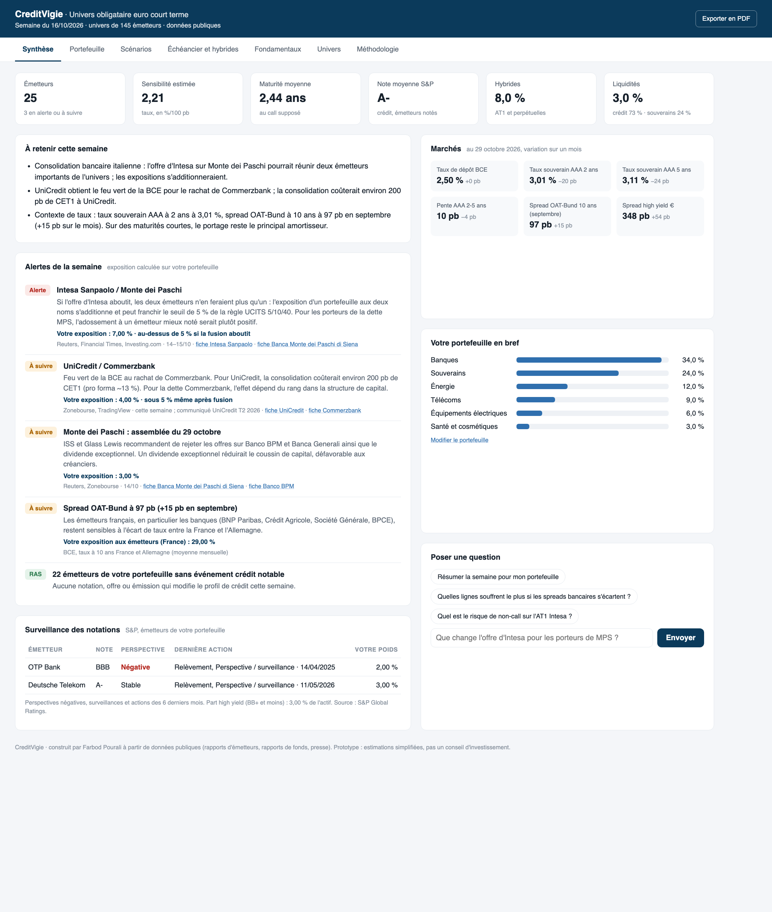
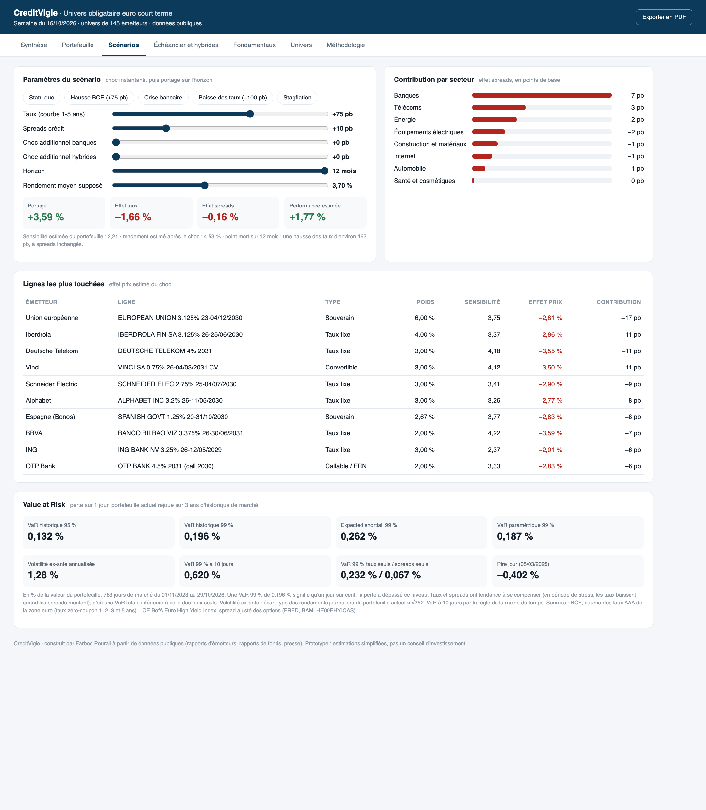

# CreditVigie

A credit risk dashboard for a universe of 145 euro short-term bond issuers (205 bonds), built in Python.

**Live demo:** https://farbodpourali.github.io/creditvigie/ (the interface is in French)

You build your own portfolio (issuers and weights), and every view recalculates: exposures, stress tests, Value at Risk, concentration limits, maturities and hybrids.



## What it does

- **Portfolio risk:** modified duration of each bond, portfolio sensitivity, maturity to call, breakdown by sector, country and bond type.
- **Stress tests:** instant rate and credit spread shocks, with extra shocks for banks and hybrids/AT1, plus carry over the horizon. Five preset scenarios (ECB hike, banking crisis, stagflation…).
- **Value at Risk** (`var_portefeuille.py`): historical and parametric VaR at 95 % and 99 %, expected shortfall, ex-ante volatility, rates-only and spreads-only VaR, and a rolling backtest. Each of the last ~760 trading days is replayed on today's portfolio.
- **Investment constraints:** UCITS 5/10/40 issuer concentration rule, and a merger simulator (what happens to the limit if two issuers merge).
- **Ratings:** S&P rating and outlook for 117 issuers, average rating of the portfolio, investment grade / high yield split, and a watch list of negative outlooks and recent rating actions.
- **Issuer monitoring:** weekly alerts, news collection, and H1 2026 fundamentals for the main banks and companies (CET1, leverage, LCR, net debt/EBITDA), taken from the issuers' own publications.
- **AI:** news is collected per issuer and analysed with the Claude API (`analyse.py`, structured outputs) to flag credit events.



## How the VaR works

A simple factor model, the same idea as a sensitivity-based VaR in a risk system:

```
daily return of a bond = −duration × (change in the euro rate at its maturity + change in its credit spread)
```

- **Rates:** ECB euro area AAA yield curve, spot rates at 1, 2, 3 and 5 years. Each bond uses the maturity closest to its call date.
- **Spreads:** ICE BofA Euro High Yield index option-adjusted spread (FRED). A bond's spread moves in proportion to its level ("Duration Times Spread", Ben Dor et al., 2007): assumed at 60 bp for investment grade and 200 bp for high yield, AT1 and hybrids.
- **Historical VaR:** the loss exceeded on only 1 % (or 5 %) of the past days. **Parametric VaR:** 2.326 × standard deviation, assuming normal returns.
- **Backtest:** VaR from the previous 250 days compared with the next day's return, for the example portfolio.

Limits: the spread between euro area governments (BTP-Bund, OAT-Bund) is not modelled, and all issuers in the same category follow the same spread index.

## Files

| File | Role |
|---|---|
| `var_portefeuille.py` | Downloads market history (ECB, FRED), computes the VaR and the factor data used by the dashboard |
| `marche.py` | Market indicators from the ECB and FRED (rates, OAT-Bund spread, high yield spread) |
| `build_dashboard.py` | Assembles the universe, fundamentals and VaR data into the dashboard |
| `lookup_lei.py` | Finds each issuer's LEI in the public GLEIF registry |
| `fetch_news.py`, `analyse.py`, `veille.py`, `rapport.py` | News collection, Claude analysis and the weekly report |
| `import_capital_iq.py` | Imports S&P Capital IQ ratings and ratios (private version only) |
| `dashboard/index.html` | The dashboard (HTML/JavaScript, no framework) |
| `docs/index.html` | The built public version, served by GitHub Pages |

```bash
pip install -r requirements.txt
python marche.py
python var_portefeuille.py
```

## Data and sources

- Bond universe: published holdings of a short-term euro bond fund (public reports), without weights.
- Fundamentals: the issuers' H1 2026 publications.
- Market data and history: ECB (deposit rate, AAA yield curve, 10-year yields) and FRED (ICE BofA index).
- Credit ratings: S&P Global Ratings long-term issuer ratings and outlooks, as of 01/11/2026.
- The private version also uses S&P Capital IQ financial ratios through an academic licence. Those ratios are **not** included in this repository or in the public demo.

Prototype built on public data, with simplified estimates. Not investment advice.

Farbod Pourali, HEC Paris
